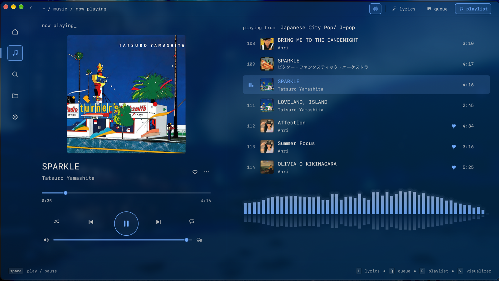
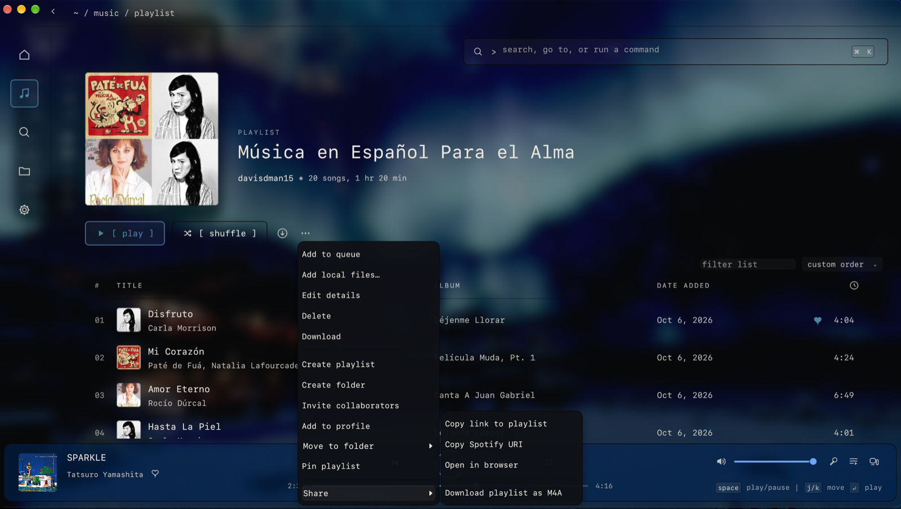

<div align="center">

# Glass

A Spotify player for the Mac that looks like a terminal window made of smoked glass.

**[Download the latest version](https://github.com/davishann15-commits/glass-releases/releases/latest)**<br>
macOS 12 or later, Apple silicon or Intel. Playback needs Spotify Premium.

<br>


</div>

<br>

Glass does the things you'd expect from a Spotify app: your library, search,
playlists, the queue, Spotify Connect, the DJ, and downloads for listening
offline. It's written in Rust and draws everything itself, so it starts fast,
and it uses next to no CPU while it waits in the background.

It also does a few things the official app doesn't. Lyrics follow the song word
by word. The Now Playing screen takes its colors from the album cover. You can
save songs as ordinary M4A or MP3 files. The whole look lives in a text file you
can edit, and almost everything has a keyboard shortcut.

## Install

1. Download `Glass-<version>.dmg` from the
   [latest release](https://github.com/davishann15-commits/glass-releases/releases/latest),
   open it and drag Glass to Applications.
2. The first time you open Glass, macOS refuses because the app isn't notarized
   by Apple. Open System Settings → Privacy & Security, scroll down and click
   Open Anyway. (In Terminal, `xattr -dr com.apple.quarantine /Applications/Glass.app`
   does the same.)
3. Sign in with Spotify. Your browser opens Spotify's own sign-in page, so Glass
   never sees your password.

Glass keeps itself up to date after that. New versions download in the
background and install the next time you quit. Each one is signed, and Glass
won't install anything whose signature doesn't check out. Settings → Updates
turns this off.

Lyrics translation is optional. It uses Apple's on-device translation on
macOS 26 and later, or the assistant if you've turned it on.

## Now Playing



Press `L` or click the cover. The lyrics come from [LRCLIB](https://lrclib.net),
then from Spotify, and the line being sung is highlighted (the word, when the
lyrics have word timing). If they're the wrong lyrics, choose others and Glass
remembers your pick for that song. If they run early or late, `[` and `]` move
them for that song. Translations can go under each line or replace it.

With album colors on, the window picks up the colors of the cover. When the
song changes, the new cover fades in and its colors spread out from it. You can
turn this off in Settings → Display.

`Q` shows the queue and `P` the playlist or album you're playing from, so you can
jump to any song in it. `V` turns the visualizer on and off. It follows music
played on this computer, so it stays flat while Glass is controlling your phone
or a speaker.

## Home, your library and search


Home has your recent playlists and albums, your top artists and the DJ. Start
the DJ from its card, or type `dj` in the command bar, and X picks songs and
introduces them in X's own voice. If you'd rather have just the music, turn off
the voice in Settings → Playback.


Your library is a numbered list of Liked Songs, Local Files, playlists, albums,
artists and downloads. `j` and `k` (or the arrow keys) move, `Enter` opens and
`⇧Enter` plays. The panel on the right holds the queue, your devices, the lyrics
or the assistant.


On a playlist or album, click a song to play it, or `⌘`-click and `⇧`-click to
select several. `/` filters the list, and the column headers sort it. From
there you can add songs to other playlists, download the whole thing for
offline listening, or save it as files.


`⌘K` opens the command bar wherever you are. Type to find something in your
library, go to a page, or run a command such as "queue" or "theme panel". Press
`Enter` to search Spotify.

## Saving songs as files



Right-click a song, playlist, album or artist and choose Share → Download as
M4A. Glass saves tagged files (title, artists, album, track number, year and
cover) to `~/Music/Glass`, which Local Files already shows.

The audio doesn't come from Spotify. Glass finds each song on JioSaavn or, if
it isn't there, on YouTube Music, matching it by title, artists and length.
M4A keeps that audio as it is (up to 320 kbps). MP3 converts it at the bitrate
you pick in Settings → Save songs, which is also where you change the folder.
Everything happens inside Glass; there's nothing else to install.

A playlist or album goes into its own folder, three songs at a time, and you
can stop it from the Share menu. Playlists also get an `.m3u8` file in the
right order. Run it again later and only the missing songs are fetched.

Podcasts and audiobooks can't be saved this way. Please only keep music you
have the right to keep.


## Your own music

Local Files plays the music on your Mac (MP3, M4A, FLAC, Ogg, WAV and AIFF),
organized by album, song, artist or genre. Local songs in your Spotify
playlists play too, and you can make playlists of local files that live only
in Glass.

If you use Glass on more than one computer, it can send songs between them over
your home network. This is off until you turn it on in Settings → Your Library,
on each computer. The first time two computers connect, both show the same
six-digit code, and nothing is sent until you confirm it on each one.

## Make it yours


`⌘T` opens the theme panel. Changes show up right away and are saved to
`~/.config/glass/theme.toml`, which you can also edit by hand. Glass reloads the
file when you save it. If something in it is wrong, Glass tells you what and
keeps using the last good version.

```toml
[theme]
background = "#0F1115"   # the window's tint
foreground = "#E9E4DC"   # text
accent     = "#4F83A3"
border     = "#090A0B"
opacity    = 0.45        # 0 is clear glass, 1 is solid
blur       = 28          # background blur, 0–100

[font]
family = "SF Mono"       # any installed font
size   = 13.0            # everything scales from this
lyrics = "SF Mono"       # "system" is SF Pro

[lyrics]                 # colors, size, alignment, spacing, fade, animation
[visualizer]             # style (bars, mirror or wave), colors, bars, height, glow
```

Settings has the rest: gapless playback, normalized volume, a six-band
equalizer, mono, streaming quality, explicit content, the cache size, a proxy,
opening at login and the name other Spotify apps see.

## Keyboard shortcuts

None of these fire while you're typing in a field. `⌘/` shows them all.

| Keys | |
|---|---|
| `space` | Play or pause |
| `⌘ ←` / `⌘ →` | Previous or next song |
| `⇧⌘ ←` / `⇧⌘ →` | Seek |
| `⌘ ↑` / `⌘ ↓` | Volume |
| `⌘K` | Command bar |
| `⌘T` | Theme panel |
| `⌘J` | Assistant |
| `/` or `⌘F` | Filter the page |
| `⌘[` / `⌘]` | Back and forward |
| `L` · `Q` · `P` | Now Playing with the lyrics, the queue, or what's playing |
| `D` | Devices (on Now Playing) |
| `V` | Visualizer |
| `[` / `]` | Move this song's lyrics earlier or later |
| `j` / `k`, `Enter`, `⇧Enter` | Move, open, play |
| `Esc` | Close whatever is on top |

## The assistant

`⌘J` opens an assistant you can ask about your music or tell what to play ("an
hour of city pop", "something like this"). It uses your ChatGPT Plus or Pro
plan, or your own OpenAI API key, and does nothing until you sign in. Queueing
or liking more than 20 songs in one go asks you first.

## Privacy

Glass has no analytics, telemetry or crash reporting. It talks to Spotify,
to LRCLIB for lyrics and to GitHub for updates. It contacts JioSaavn and
YouTube Music only when you save songs, OpenAI only if you use the assistant,
and your other computers only if you turn on sharing. The Activity page lists
who Glass talks to and logs its requests to Spotify and LRCLIB.

| Where | What |
|---|---|
| `~/.config/glass/` | `theme.toml` and `config.toml`, once you change something |
| `~/Library/Application Support/Glass/` | Preferences, your Spotify sign-in (only you can read it), lyrics picks, local playlists |
| `~/Library/Caches/Glass/` | The streaming cache, downloads (encrypted, as Spotify sends them) and saved lyrics |
| `~/Music/Glass/` | Songs you save as files |
| Keychain | The assistant's sign-in |

Downloads stay encrypted and play only in Glass while you're signed in. Songs
you save as files are ordinary M4A or MP3 files.

## Questions

**Why does it need Spotify Premium?** Glass plays music through librespot, an
open-source Spotify player that only works with Premium accounts.

**Why does macOS say it can't check Glass for malware?** Glass isn't notarized
by Apple. Step 2 of [Install](#install) gets past it.

**Is there a Windows version?** No. There's an Arch Linux build, but it isn't
published here.

---

<sub>Glass isn't affiliated with or endorsed by Spotify. Spotify is a trademark of Spotify AB. This repository holds the released app only. The Now Playing, Home and playlist-menu screenshots show a real library; the others use Glass's demo library. Album art and lyrics belong to their owners.</sub>
