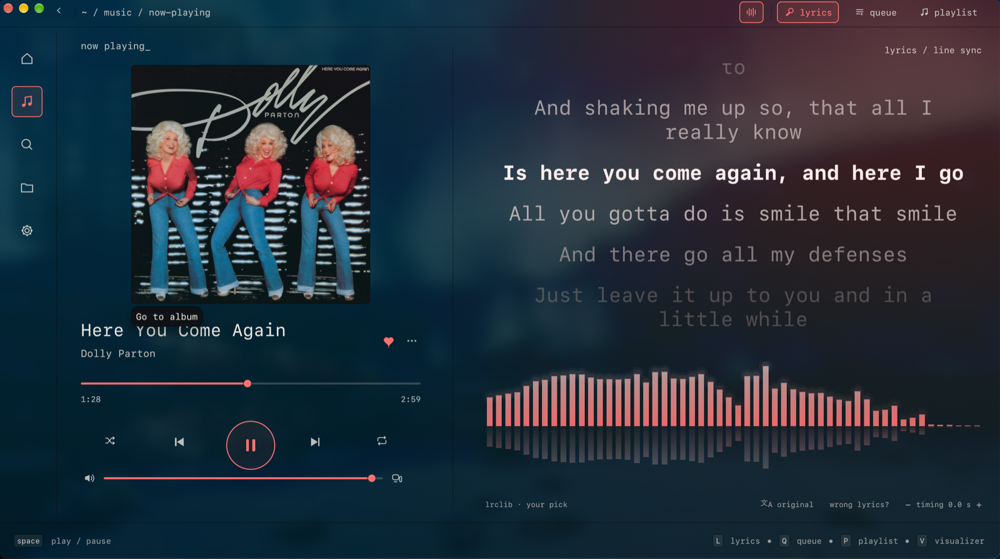
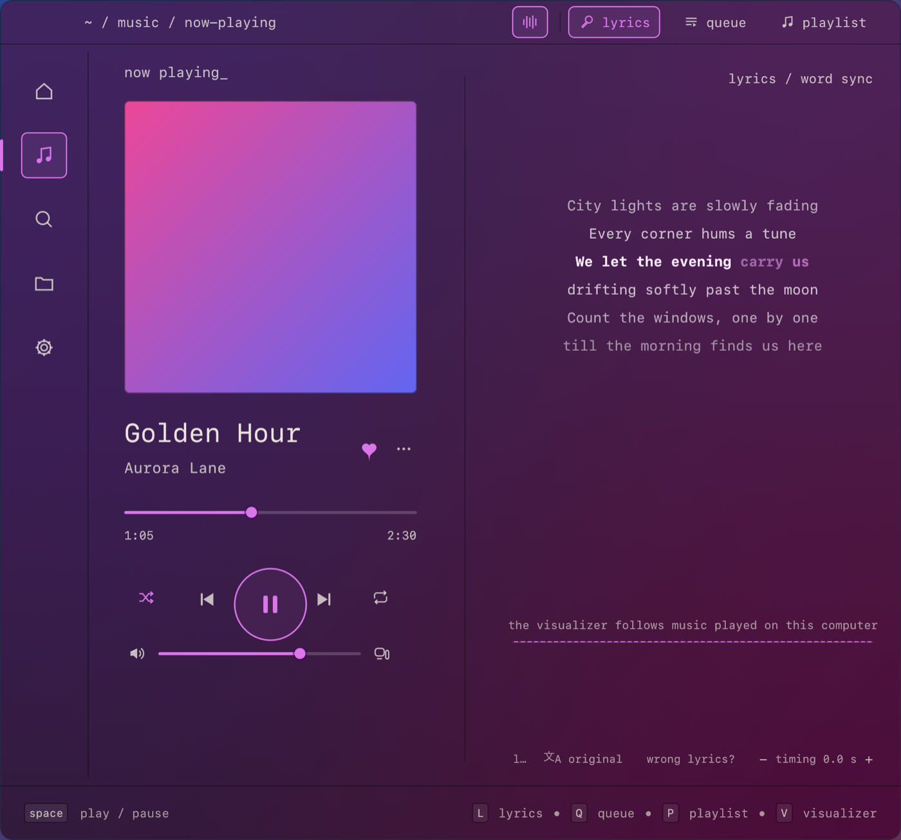
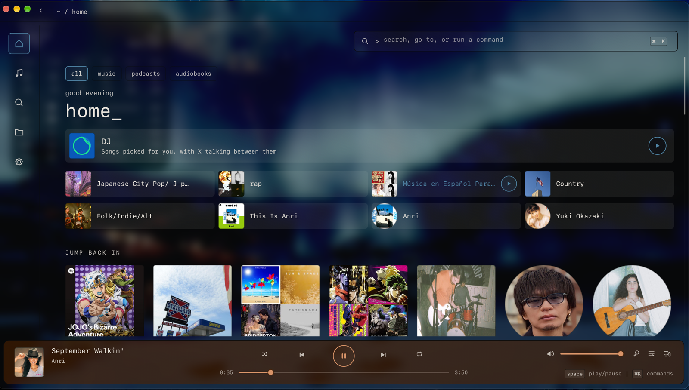
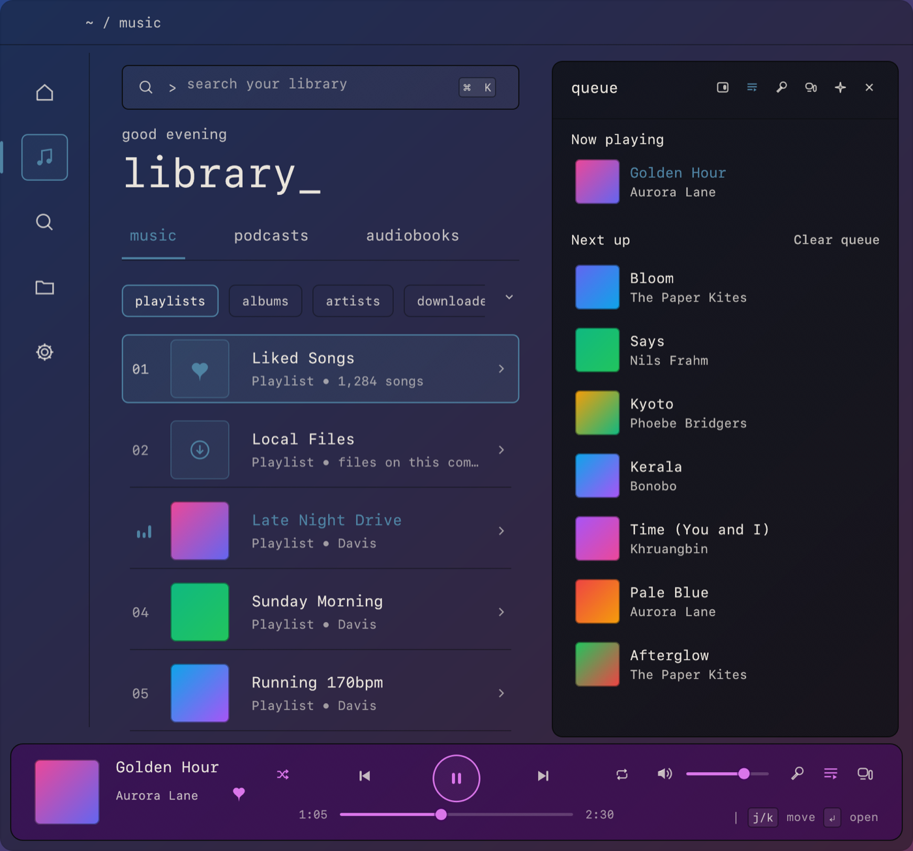
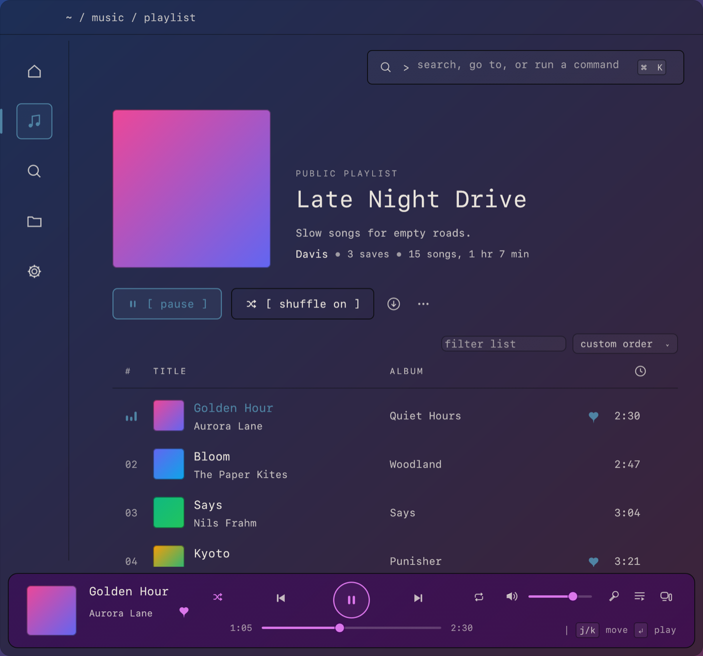
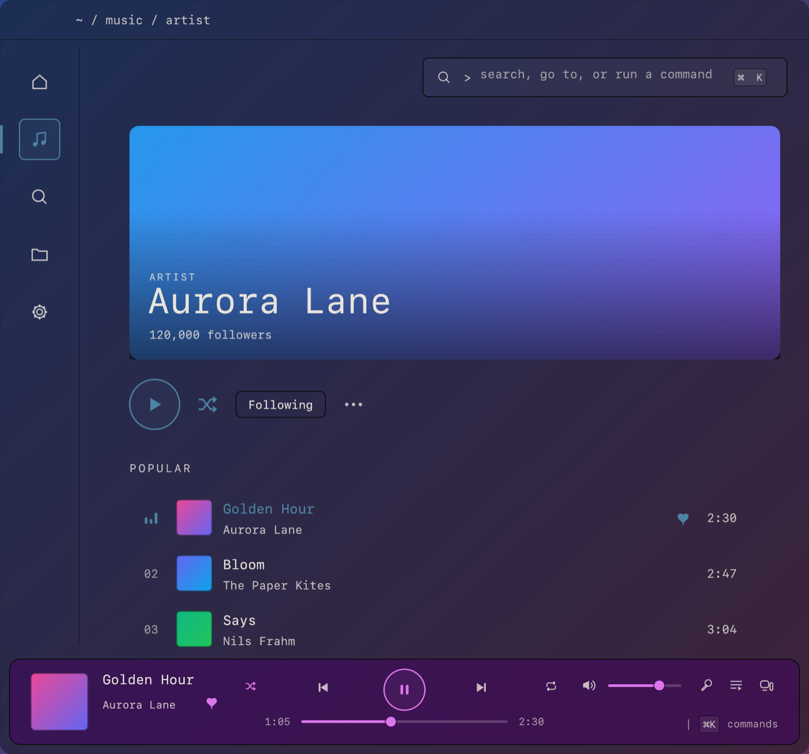
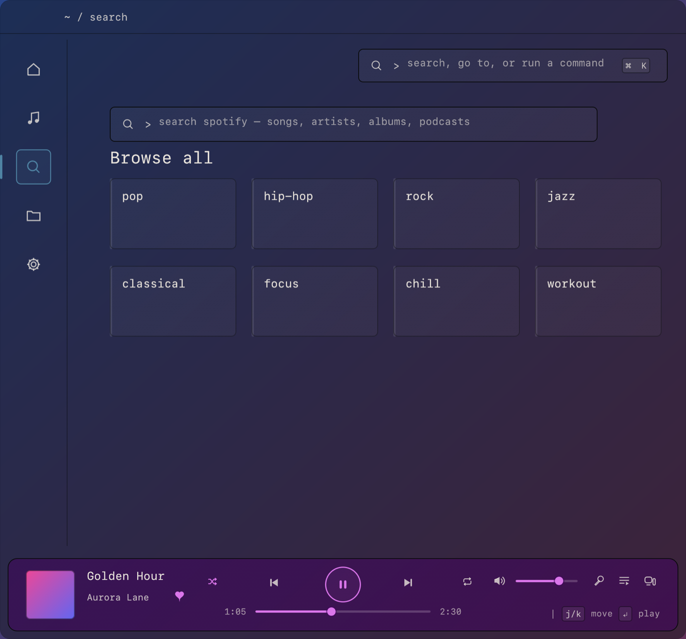
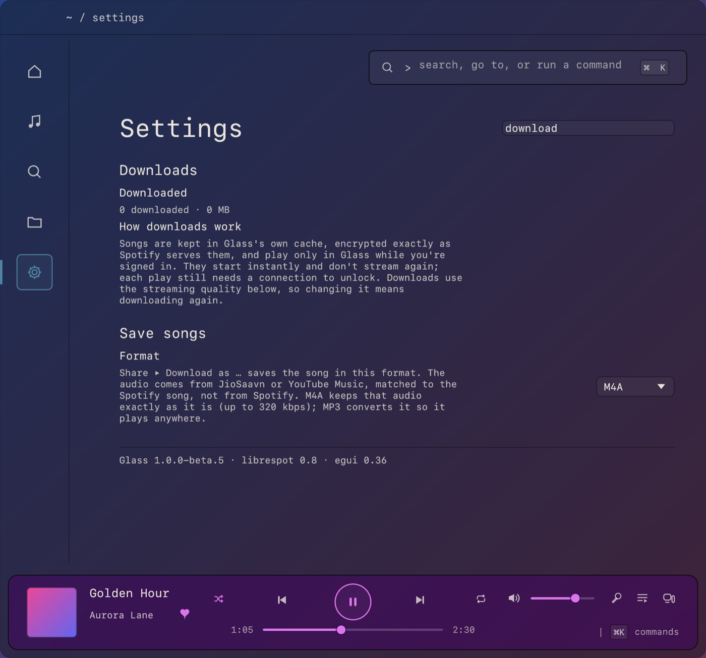
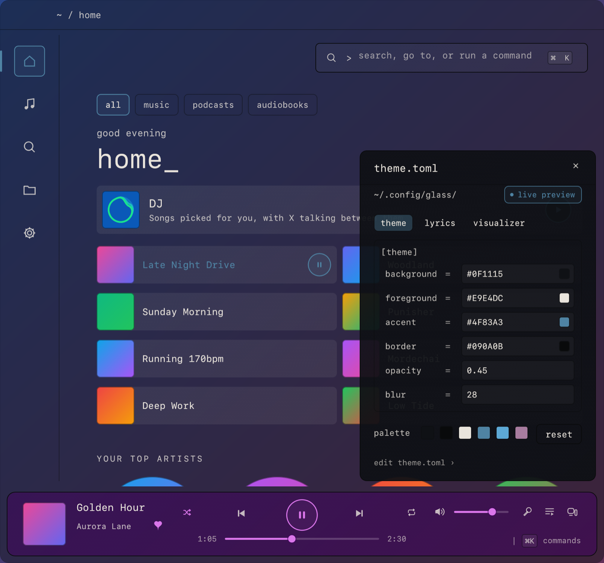

<div align="center">

# Glass

**A quiet, transparent Spotify client for macOS, written in Rust.**

Your library, search, playlists, Spotify Connect, word-synced lyrics, the DJ and offline downloads,<br>
in a pane of smoked glass with monospaced type.

### [⬇ Download Glass for macOS](https://github.com/davishann15-commits/glass-releases/releases/latest)

macOS 12 or later · Apple silicon and Intel · Spotify Premium

<br>



</div>

<br>

## Contents

- [Highlights](#highlights)
- [Install](#install)
- [A tour](#a-tour)
  - [Now Playing](#now-playing) · [Home](#home) · [Library and queue](#library-and-queue) · [Playlists and albums](#playlists-and-albums) · [Artists](#artists) · [Search and the command bar](#search-and-the-command-bar)
- [Save songs as files](#save-songs-as-files)
- [Make it yours](#make-it-yours)
- [Keyboard shortcuts](#keyboard-shortcuts)
- [Updates](#updates)
- [Privacy and what's stored](#privacy-and-whats-stored)
- [FAQ](#faq)

## Highlights

| | |
|---|---|
| 🎨 **Now Playing in the album's colors** | The window takes its colors from the cover that's playing. When the song changes, the artwork crossfades and the new colors bloom out from it. |
| 🎤 **Word-synced lyrics** | Lyrics follow the song line by line, and word by word where they're available, with an audio visualizer underneath. Fix timing per song with `[` and `]`. |
| 💾 **Save songs as files** | Share ▸ *Download as M4A* on any song, playlist, album or artist saves tagged audio files with their cover art. Nothing else to install. |
| 📻 **The DJ, with X's voice** | Spotify's DJ plays in Glass, with X introducing the songs. |
| 🔊 **Spotify Connect** | Play on any of your devices, or control Glass from your phone. |
| 📁 **Local files, like iTunes** | Albums, Songs, Artists and Genres from your own folders. Local songs in your Spotify playlists play too, and you can send songs to Glass on your other computers. |
| ⬇️ **Downloads** | Keep playlists, albums and Liked Songs on your Mac so they start instantly and never stream again. |
| ⌨️ **Keyboard first** | Everything has a key. `⌘K` searches, navigates and runs commands. |
| 🪟 **Make it yours** | Colors, blur, fonts, lyrics and the visualizer, live from a panel (`⌘T`) or a plain text file. |
| ✨ **Assistant** | Ask about your music or tell it what to play, with your ChatGPT Plus or Pro account. |
| 🔄 **Updates itself** | New versions download in the background and install when you quit. Only signed updates are accepted. |
| 🔒 **Private** | No analytics, telemetry or crash reporting. |

## Install

1. Download **`Glass-<version>.dmg`** from the [latest release](https://github.com/davishann15-commits/glass-releases/releases/latest).
2. Open it and drag **Glass** to **Applications**.
3. Open Glass. The first time, macOS stops it because Glass isn't notarized by Apple. Go to **System Settings → Privacy & Security**, scroll down and click **Open Anyway**.
   (Or, in Terminal: `xattr -dr com.apple.quarantine /Applications/Glass.app`.)
4. Sign in with Spotify. Playback needs **Spotify Premium**.

That's it. From then on Glass keeps itself up to date.

| Requirement | |
|---|---|
| macOS | 12 Monterey or later, Apple silicon or Intel (one universal app) |
| Spotify | A Premium account |
| Lyrics translation | Optional. Uses Apple's on-device translation on macOS 26 and later, or the assistant |

Glass also runs on Arch Linux, but only the macOS app is published here.

## A tour

### Now Playing



<sub>The same screen with another album: the colors follow the cover (compare the screenshot at the top).</sub>

Press `L` or click the cover. The artwork and controls are on the left, and the lyrics are on the right, following the song. The word being sung is highlighted.

- **Album colors.** The window is tinted from the cover: a soft wash of its main colors, and its brightest color for the progress bar, buttons and lyrics. When the song changes, the new cover fades in once it has loaded (no empty flash), the title follows it, and the new colors spread out from the artwork. The next song's cover is fetched ahead of time so the change starts right away. Turn it off in **Settings → Display**.
- **Visualizer** (`V`): bars, mirrored bars or a wave that move with the music played on this computer.
- **Queue** (`Q`), **devices** (`D`) and **the playlist that's playing** (`P`) open in the same place, so you can pick any song from the album or playlist you're in.
- **Wrong lyrics?** Choose others, and Glass remembers your pick for that song. Shift a song's timing with `[` and `]`, or with the `− timing +` control. Lyrics come from [LRCLIB](https://lrclib.net), then Spotify.
- **Translation:** show the translation below each line, or on its own.

### Home



Your recent playlists and albums, your top artists and the DJ. Click the DJ card, or type `dj` in `⌘K`, and X picks songs for you and introduces them in X's own voice. What X says shows in the player bar. **Settings → Playback → DJ voice** turns the talking off.

The player bar at the bottom takes the playing album's accent on every page, so you always see what's on.

### Library and queue



Your library is a numbered list: Liked Songs, Local Files, playlists, albums, artists and downloads. Move with `j`/`k` or the arrows, `Enter` opens, and `⇧Enter` plays. The side panel shows the queue, your devices, the lyrics or what's playing.

### Playlists and albums



One click plays a song; `⌘`-click and `⇧`-click select several. Filter the list with `/`, sort it by any column, add songs to playlists, download it for offline listening, or save it as audio files (see below).

### Artists



Popular songs, albums and singles, appearances and related artists, plus artist radio.

### Search and the command bar



Search Spotify for songs, artists, albums and podcasts, or browse by genre. Anywhere in Glass, `⌘K` searches your library, goes to a page or runs a command ("queue", "liked songs", "theme panel"), and `Enter` searches Spotify.

## Save songs as files



Right-click a song, playlist, album or artist and choose **Share → Download as M4A**. Glass saves tagged audio files, with title, artists, album, track number, year and cover art, to **`~/Music/Glass`**, which Local Files already shows.

- **Whole collections.** A playlist, album or an artist's top songs goes into its own folder, three songs at a time. The Share menu shows the progress ("Downloading playlist as M4A… 12 of 50") and a **Stop** button. One message sums it up at the end, and playlists also get an `.m3u8` file that keeps their order. Run it again later to fetch only what's missing or new.
- **Formats.** **M4A** keeps the source audio exactly as it is, up to 320 kbps. **MP3** converts it so it plays anywhere, at the bitrate you choose (128–320 kbps).
- **Where the audio comes from.** Not Spotify. Each song is found on JioSaavn and, if it isn't there, on YouTube Music, matched by title, artists and length. Everything runs inside Glass: there's nothing extra to install.
- **Settings → Save songs** chooses the format, MP3 bitrate and folder, and can add the folder to Local Files.

Podcasts and audiobooks can't be saved this way. Please only save music you have the right to keep.

## Make it yours



Press `⌘T` for the theme panel. Every change shows at once and is written to **`~/.config/glass/theme.toml`**, a plain text file you can also edit by hand. Glass reloads it when you save. A mistake never breaks the look: Glass shows what's wrong and keeps the last good theme.

```toml
[theme]
background = "#0F1115"   # window tint
foreground = "#E9E4DC"   # text
accent     = "#4F83A3"
border     = "#090A0B"
opacity    = 0.45        # 0 = clear glass … 1 = solid
blur       = 28          # background blur, 0–100

[font]
family = "SF Mono"       # any installed font
size   = 13.0            # everything scales from this
lyrics = "SF Mono"       # "system" is SF Pro

[lyrics]                 # colors, size, alignment, spacing, fade, animation
[visualizer]             # style (bars, mirror, wave), colors, bars, height, glow
```

Settings also covers playback (gapless, crossfade, normalize volume, a 6-band equalizer, mono), streaming quality, explicit content, the cache size, a proxy, opening at login and the device name other Spotify apps see.

## Keyboard shortcuts

None of these fire while you're typing in a field. `⌘/` lists them all in the app.

| Keys | |
|---|---|
| `space` | Play / pause |
| `⌘ ←` / `⌘ →` | Previous / next |
| `⇧⌘ ←` / `⇧⌘ →` | Seek |
| `⌘ ↑` / `⌘ ↓` | Volume |
| `⌘K` | Command bar: search, go to, run a command |
| `⌘T` | Theme panel |
| `⌘J` | Assistant |
| `/` or `⌘F` | Filter the page |
| `⌘[` / `⌘]` | Back / forward |
| `L` · `Q` · `P` · `D` | Now Playing: lyrics, queue, the playlist that's playing, devices |
| `V` | Show or hide the visualizer |
| `[` / `]` | Shift this song's lyrics timing |
| `j` / `k`, `Enter`, `⇧Enter` | Move, open or play, play or add to queue |
| `Esc` | Close the top-most thing |

## Updates

Glass checks for a new version shortly after it starts and every few hours, downloads it in the background, and installs it when you quit. Choose *update to … · restart* at the top of the window to install it right away. Every update is signed with Glass's release key, and Glass installs only updates whose signature checks out. **Settings → Updates** checks now or turns automatic updates off.

## Privacy and what's stored

Glass has **no analytics, telemetry or crash reporting**. It talks to Spotify, LRCLIB for lyrics, GitHub to check for updates, and, when you use them, JioSaavn and YouTube Music to save songs and OpenAI for the assistant.

| Where | What |
|---|---|
| `~/.config/glass/theme.toml`, `config.toml` | Your theme and lyrics settings, once you change them |
| `~/Library/Application Support/Glass/` | Preferences, your Spotify sign-in (readable only by you), lyrics picks, local playlists |
| `~/Library/Caches/Glass/` | The streaming cache and downloads (encrypted exactly as Spotify serves them), and saved lyrics |
| `~/Music/Glass/` | Songs you save as files |
| Keychain | The assistant's sign-in |

Downloads stay encrypted and play only in Glass while you're signed in. Songs you save as files are ordinary M4A or MP3 files.

## FAQ

**Why does Glass need Spotify Premium?** Glass plays music with librespot, an open-source Spotify player that only works with Premium accounts.

**Why does macOS say it can't check Glass for malware?** Glass isn't notarized by Apple. See step 3 of [Install](#install).

**The visualizer is flat.** It follows music played on this computer. When Glass controls another device, there's nothing here to show.

**Where are my saved songs?** In `~/Music/Glass`, or the folder you picked in Settings → Save songs.

**How do I turn off the album colors?** Settings → Display → *Match Now Playing to the album's colors*.

**Is there a Windows version?** No.

---

<sub>Glass isn't affiliated with or endorsed by Spotify. Spotify is a trademark of Spotify AB. This repository holds the released app only. The top screenshot shows a real album; the others use Glass's demo library. Album art and lyrics belong to their owners.</sub>
