<div align="center">

# Glass

A Spotify player for the Mac and iPhone that looks like a terminal window made of smoked glass.

**[Download the latest version](https://github.com/davishann15-commits/glass-releases/releases/latest)**<br>
macOS 12 or later, Apple silicon or Intel. Playback needs Spotify Premium.

**[Get Glass for iPhone](https://github.com/davishann15-commits/glass-releases/releases/tag/ios-v1.0.0-beta.23)** (new)<br>
iOS 26 or later, iPhone and iPad, installed with SideStore, AltStore, Sideloadly or TrollStore.

**[Get Glass for Arch Linux](https://github.com/davishann15-commits/glass-releases/releases/tag/arch-v1.0.0-beta.23)** (new)<br>
A pacman package for x86_64, Wayland or X11; the PKGBUILD builds it anywhere else.

**[Browse the source](source/)** · **[Build from source](#build-from-source)** · **[Developer guide](source/README.md)** · **[Glass for iPhone](#glass-for-iphone)** · **[Arch Linux](#install-on-arch-linux)**

<br>


</div>

<br>

Glass does the things you'd expect from a Spotify app: your library, search,
playlists, the queue, Spotify Connect, the DJ, and downloads. It's written in Rust and draws everything itself, so it starts fast,
and it uses next to no CPU while it waits in the background.

It also does a few things the official app doesn't. Lyrics can be translated,
under each line or in place of it. The Now Playing screen takes its colors from
the album cover. You can
save songs as ordinary M4A or MP3 files. Entire playlists can be downloaded locally, and IOS users have the ability to add their local songs to Apple Music, natively. While Free Users cannot stream songs, they can still view them and download them locally. The whole look lives in a text file you
can edit, and almost everything has a keyboard shortcut.

## Install

1. Download `Glass-<version>.dmg` from the
   [latest release](https://github.com/davishann15-commits/glass-releases/releases/latest),
   open it and drag Glass to Applications.
2. The first time you open Glass, macOS refuses because the app isn't notarized
   by Apple. Open System Settings → Privacy & Security, scroll down and click
   Open Anyway. (In Terminal, `xattr -dr com.apple.quarantine /Applications/Glass.app`
   does the same.)
3. Sign in with Spotify. Your browser opens Spotify's own sign-in page, so Glass
   never sees your password.

Glass keeps itself up to date after that. New versions download in the
background and install the next time you quit. Each one is signed, and Glass
won't install anything whose signature doesn't check out. Settings → Updates
turns this off.

### Install on Arch Linux

Download the package from the
[Arch Linux release](https://github.com/davishann15-commits/glass-releases/releases/tag/arch-v1.0.0-beta.23)
and install it with pacman:

```sh
curl -LO https://github.com/davishann15-commits/glass-releases/releases/download/arch-v1.0.0-beta.23/glass-1.0.0beta23-1-x86_64.pkg.tar.zst
sudo pacman -U glass-1.0.0beta23-1-x86_64.pkg.tar.zst
```

Or put the release's `PKGBUILD` in an empty folder and run `makepkg -si` there
to build it from this repository's source. On a Wayland compositor that blurs
behind windows (Hyprland, KWin), the window is see-through and blurred like the
Mac's. Glass says when a new version is out; install it the same way. It isn't
in the AUR yet, because Arch has closed new AUR accounts for now.

Lyrics translation is optional. It uses Spotify's own translation when there
is one, Apple's on-device translation on macOS 26 and later, or the assistant
once you've signed in to it.

## Build from source

The [`source/`](source/) folder contains the Glass **1.0.0-beta.23** source code and what's
new since the Mac release: word-by-word lyrics and the theme panel's album tab.
The Arch Linux package already has them; the Mac app gets them in its next
release. The source was published from development commit
`c0909fd1036517ddad35c0d58260e16975cf0db6`.

Install stable Rust with [rustup](https://rustup.rs). On macOS, also install
Apple's command-line developer tools (`xcode-select --install`), Autoconf,
Automake and Libtool (`brew install autoconf automake libtool`). Then:

```sh
git clone https://github.com/davishann15-commits/glass-releases.git
cd glass-releases/source
./scripts/bundle.sh
open target/Glass.app
```

For development, use `cargo run`. The source also supports Arch Linux; see the
[developer guide](source/README.md) for Linux packaging, configuration, tests and
release tooling. Vendored dependencies are included under [`source/vendor/`](source/vendor/),
including the LAME source required by macOS builds. Clone the repository to
build on macOS; GitHub's automatic source archives omit LAME because the Arch
source package uses the system library.

Glass's code is [MIT licensed](LICENSE). Third-party components keep their own
licenses; see [third-party notices](source/packaging/THIRD-PARTY-NOTICES.txt).

## Glass for iPhone

<p align="center">
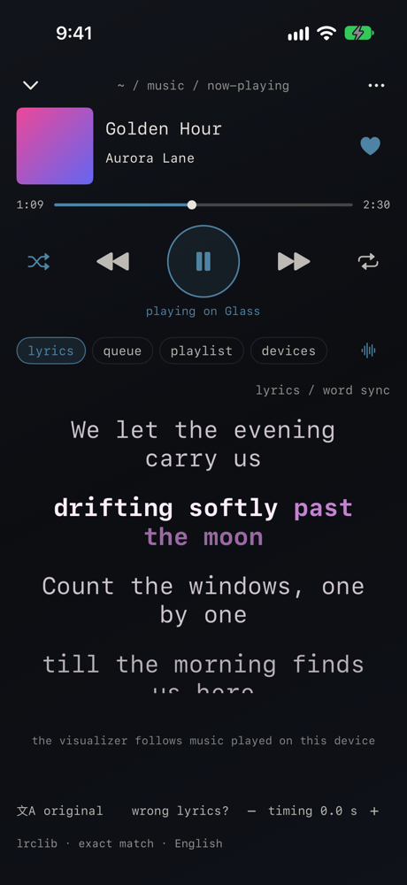
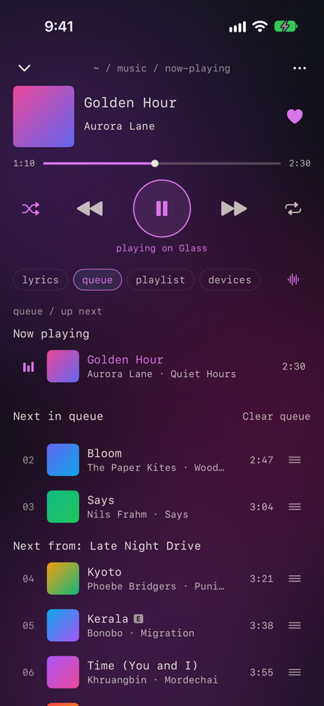
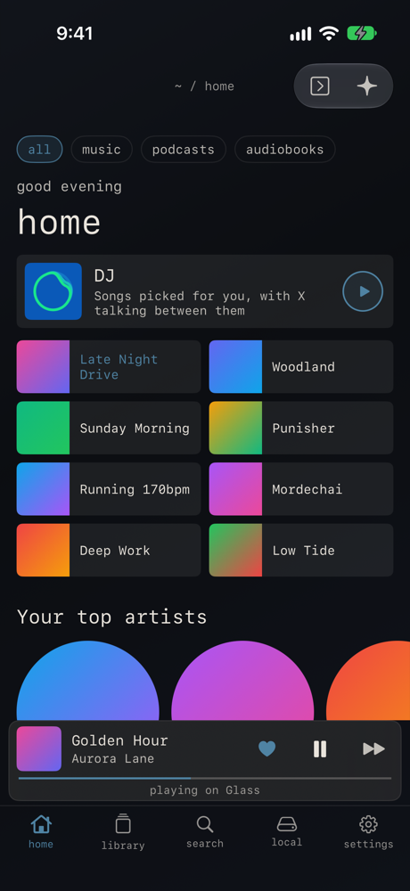
</p>

The same player, built for touch. Glass for iPhone has everything the Mac app
has (your library, search, every page, lyrics and translation, the queue,
Spotify Connect, the DJ, downloads, saving songs as files, Local Files, the theme
panel and the assistant), and a few things only a phone needs: the lock screen
and Control Center, swipes, and putting your own music into Apple Music.

### Install on iPhone

Glass isn't on the App Store, so it's installed as an `.ipa`. Download
`Glass-1.0.0-beta.23.ipa` from the [iPhone release](https://github.com/davishann15-commits/glass-releases/releases/tag/ios-v1.0.0-beta.23), then use one of these:

- **SideStore** or **AltStore**: add the `.ipa` in the app. It's signed with your
  own Apple ID; with a free Apple ID it has to be refreshed every 7 days, which
  SideStore and AltStore do for you.
- **Sideloadly** (on a Mac or PC): connect your iPhone, drop the `.ipa` in, sign
  in with your Apple ID and install.
- **TrollStore**: open the `.ipa` with TrollStore. Nothing to refresh.

Then open Glass and sign in with Spotify. Spotify's own sign-in page opens over
Glass, so Glass never sees your password; your session stays in the iPhone's
Keychain. Playing music needs Spotify Premium.

### Everything it does

<p align="center">
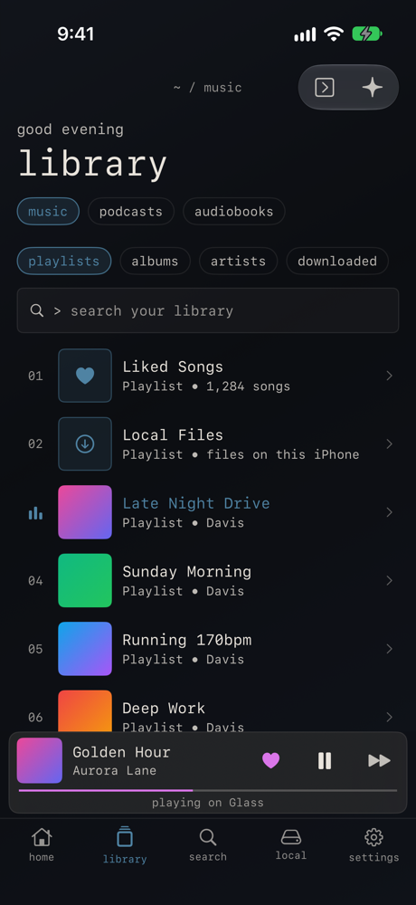
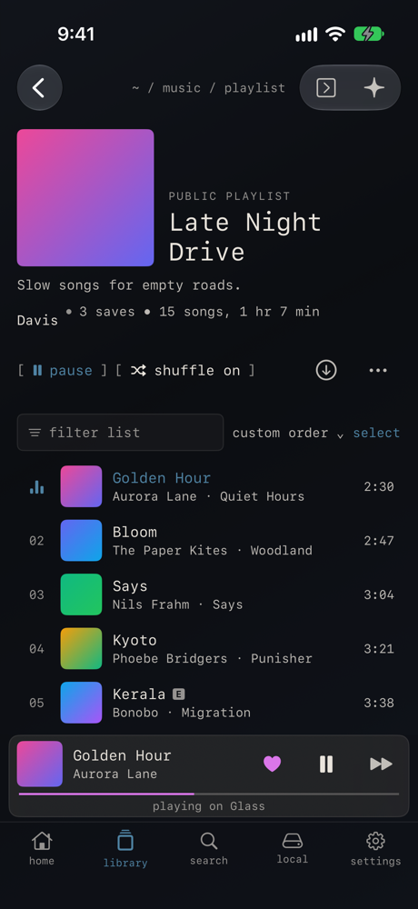
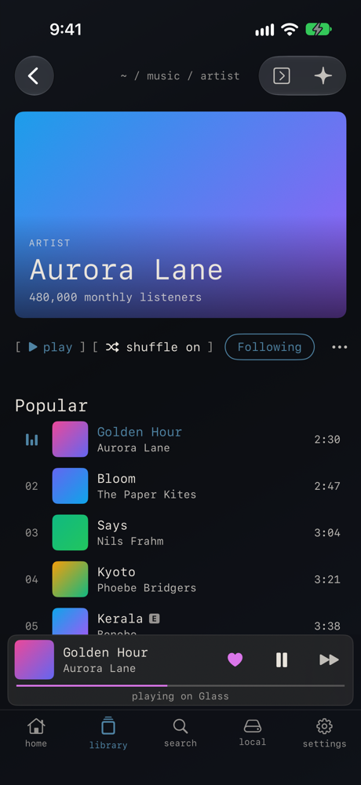
</p>

**Listening**

- **Your library**: playlists, albums, artists, podcasts and audiobooks, with
  Liked Songs, Your Episodes and Local Files at the top. Sort it, show it as a
  list, compact list or grid, pin things, keep playlists in folders, filter it to
  what's downloaded, and search it.
- **Home**: the DJ, your recent playlists and albums, Jump back in, your top
  artists, On repeat, your playlists, saved albums and shows.
- **Search**: songs, artists, albums, playlists and podcasts, with a top result,
  filters, recent searches and categories to browse.
- **Every page**: playlists (edit the name, description and cover, reorder, remove
  songs, select several, make one collaborative, filter and sort), albums,
  artists (popular songs, the discography, fans also like, appears on), shows and
  episodes, audiobooks and their chapters, songs, profiles, recents and folders.
  Long-press anything for its menu: add to a playlist, queue, like, go to the
  artist or album, start a radio, share, download.
- **Now Playing**: slide it up from the player bar and pull it down to close.
  Swipe the artwork for the next or previous song, double-tap it to like the
  song. Underneath: the lyrics, the queue, the playlist you're playing from, or
  your devices.
- **Lyrics**: from LRCLIB, then Spotify, synced by line or by word. Wrong ones?
  Choose others, and Glass remembers your pick for that song. Running early or
  late? Nudge the timing for that song. Translations go under each line or
  replace it, from Spotify, Apple's on-device translation (free, private) or the
  assistant.
- **The queue**: "Next in queue" (what you added) and "Next from" (the rest of
  the playlist or album). Drag a song's ≡ handle to reorder (while it plays on
  this iPhone). Swipe a song to queue it: to the right in Now Playing, as in
  Spotify, or to the left anywhere.
- **Playing from**: the playlist or album you're playing, opened on the song
  that's playing, so you can jump to any song or swipe songs into the queue.
- **Spotify Connect**: your iPhone is a Spotify speaker other devices can play
  to, and Glass controls your other devices: play, skip, seek, volume, move
  playback between them.
- **The DJ**: X picks songs and introduces them in X's own voice (or just the
  music, if you turn the voice off).
- **In the background**: Glass keeps playing with the phone locked. The lock
  screen, Control Center, AirPods and Bluetooth controls work. Unplugging
  headphones pauses, a call or Siri pauses, and if the connection drops after a
  long time in the background, Glass reconnects and carries on.
- **Volume**: Glass plays at full level, like other apps, and its volume rail
  is the iPhone's own volume, so the side buttons move it too.
- **Downloads**: keep playlists, albums and podcasts on the phone so they start
  at once and use no data (playing still needs a connection).
- **Sound**: normalized volume (quiet, normal or loud), gapless playback,
  autoplay, a six-band equalizer with 22 presets, mono, streaming quality up to
  320 kbps, and an explicit-content filter.
- **The visualizer** under the lyrics, following the music played on this iPhone.

<p align="center">
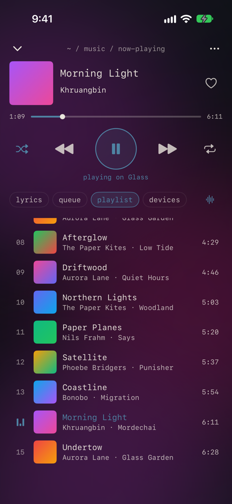
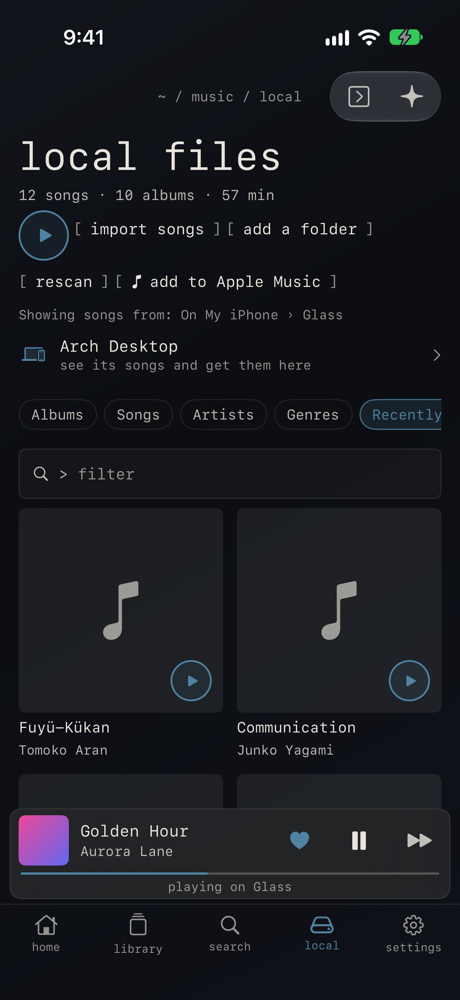
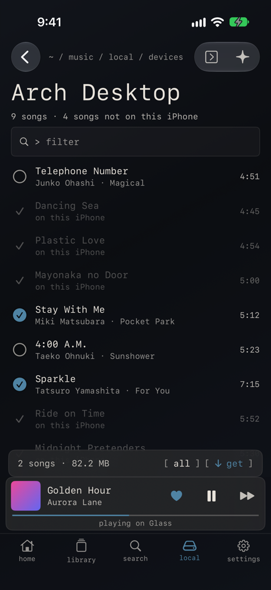
</p>

**Your own music**

- **Save songs as files**: Share → Download as M4A or MP3 on a song, playlist,
  album or artist. Files are tagged (title, artists, album, track and disc
  number, year, cover). The audio comes from JioSaavn or YouTube Music, not from
  Spotify. A downloaded playlist also becomes a local playlist with the same
  name, description, cover and order; download it again and it's brought up to
  date. Please only keep music you have the right to keep.
- **Local Files**: import songs from the Files app or add whole folders, then
  browse by album, song, artist or genre, or what's recently added. Make local
  playlists, edit a song's title, artist, album, year, genre and cover, and
  local songs in your Spotify playlists play from your files.
- **Your other devices**: Glass on your other devices, on the same Wi-Fi and
  signed in to the same Spotify account, shows up in Local Files by itself, with
  no code to type. Tap one to see its songs, pick the ones you want and get them;
  or send songs the other way. A playlist's local songs that aren't on this
  iPhone come from your other devices.
- **Add to Apple Music**: put Local Files songs (and a whole playlist) into the
  Music app's library, as your own files, even where Apple Music has the song.
  It needs the LocalDevVPN app (on the App Store) and a
  pairing file for your iPhone made once with
  [idevice_pair](https://github.com/jkcoxson/idevice_pair); the setup is
  explained in the app. Glass keeps a backup, so you can undo the last add.
  Based on [ByeTunes](https://github.com/EduAlexxis/ByeTunes) (MIT).

<p align="center">
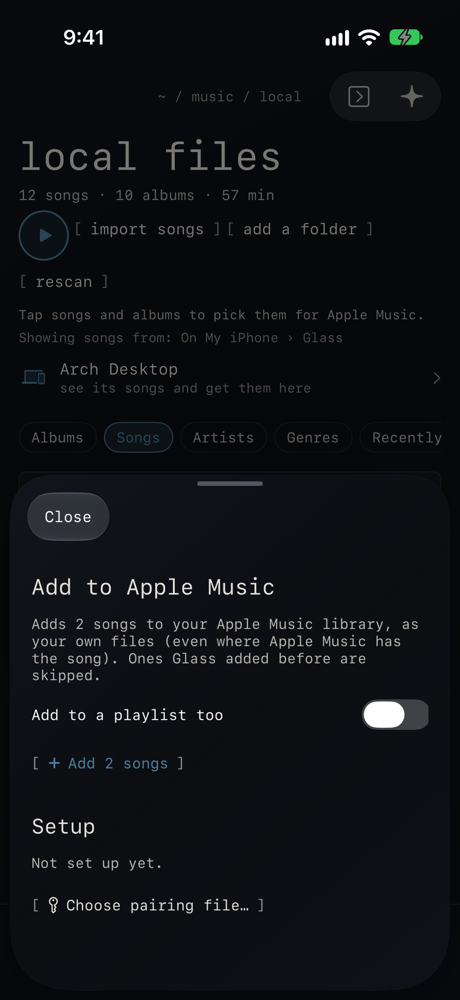
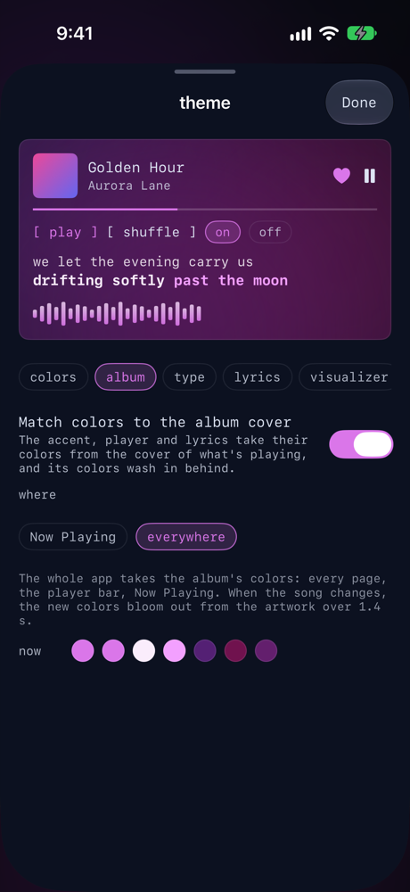
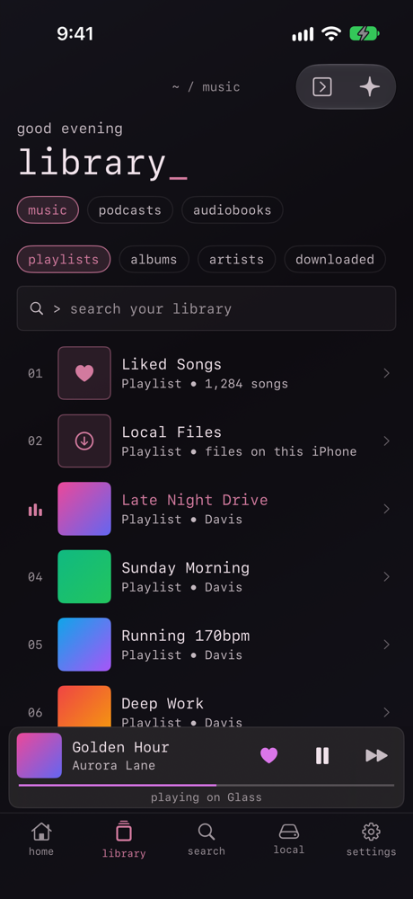
</p>

**Make it yours**

- **The theme panel**: presets, every color, how much of the tint covers the
  glass, the type size, the lyrics' look (colors, size, alignment, animation) and
  the visualizer's (style, colors, bars, glow). Export your theme to share it, or
  import one.
- **Album colors**: Now Playing takes its colors from the album cover, or the
  whole app does. When the song changes, the new colors bloom out from the cover.

**And the rest**

- **The assistant**: sign in with your ChatGPT plan or use an OpenAI API key. Ask
  it to play, queue or like songs, or to build a playlist from your library or
  your local files; it shows a preview first, and the last change can be undone.
- **The command bar**: search your library, run a command, or start with `?` to
  ask the assistant. With a keyboard attached (on an iPad, say), the Mac's
  shortcuts work too.
- **iPad**: the Mac's side rail, the library and a page side by side, the
  assistant as a column, and files dragged in from the Files app.
- **Song-change notifications**, if you want them.
- **Activity**: everything Glass stores, and every request it makes to Spotify
  and for lyrics.
- **VoiceOver**: every gesture has a VoiceOver action too.

<p align="center">
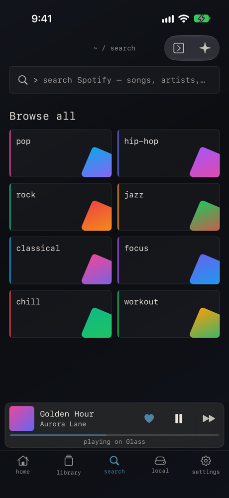
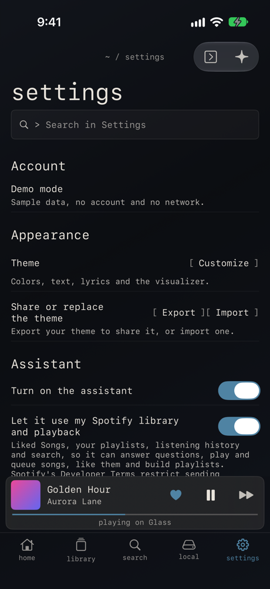
</p>

### Good to know

- Sharing with Glass on a Mac or a PC needs Glass 1.0.0-beta.23 or later there
  (earlier versions paired with a code). An older one is listed with a note to
  update it.
- Add to Apple Music writes to the Music app's library directly. Glass keeps a
  copy from before each change, but try it first on a phone whose library you
  can afford to lose.
- Glass is unofficial and isn't affiliated with Spotify or Apple. It's for
  personal use.

### Build Glass for iPhone from source

The [`source-ios/`](source-ios/) folder contains the source code of Glass for iPhone
**1.0.0-beta.23** and what's new since the `.ipa`, such as word-by-word lyrics
(development commit `c0909fd`). It's the whole tree: the iPhone app in `ios/` shares most of its code
with the Mac app in `src/`. You need a Mac with Xcode 26, Rust with the iOS targets
and [XcodeGen](https://github.com/yonaskolb/XcodeGen):

```sh
rustup target add aarch64-apple-ios aarch64-apple-ios-sim
brew install xcodegen
git clone https://github.com/davishann15-commits/glass-releases.git
cd glass-releases/source-ios/ios
xcodegen generate
open Glass.xcodeproj    # choose your team under Signing & Capabilities, then Run
```

The first build compiles the Rust core, which takes a while. See
[`ios/docs/BUILD.md`](source-ios/ios/docs/BUILD.md) for the simulator, tests and
release builds. The app's open-source licenses are in Settings → About;
LAME's source, which the app links, is in
[`source-ios/vendor/lame-3.100`](source-ios/vendor/lame-3.100).

## Now Playing


Press `L` or click the cover. The lyrics come from [LRCLIB](https://lrclib.net),
then from Spotify, and the line being sung is highlighted (the word, when the
lyrics have word timing). If they're the wrong lyrics, choose others and Glass
remembers your pick for that song. If they run early or late, `[` and `]` move
them for that song. Translations can go under each line or replace it.

With album colors on, the window picks up the colors of the cover. When the
song changes, the new cover fades in and its colors spread out from it. You can
turn this off in Settings → Display.

`Q` shows the queue and `P` the playlist or album you're playing from, so you can
jump to any song in it. `V` turns the visualizer on and off. It follows music
played on this computer, so it stays flat while Glass is controlling your phone
or a speaker.

## Home, your library and search


Home has your recent playlists and albums, your top artists and the DJ. Start
the DJ from its card, or type `dj` in the command bar, and X picks songs and
introduces them in X's own voice. If you'd rather have just the music, turn off
the voice in Settings → Playback.


Your library is a numbered list of Liked Songs, Local Files, playlists, albums,
artists and downloads. `j` and `k` (or the arrow keys) move, `Enter` opens and
`⇧Enter` plays. The panel on the right holds the queue, your devices, the lyrics
or the assistant.


On a playlist or album, click a song to play it, or `⌘`-click and `⇧`-click to
select several. `/` filters the list, and the column headers sort it. From
there you can add songs to other playlists, download the whole thing so it
starts at once (playing still needs a connection), or save it as files.


`⌘K` opens the command bar wherever you are. Type to find something in your
library, go to a page, or run a command such as "queue" or "theme panel". Press
`Enter` to search Spotify.

## Saving songs as files


Right-click a song, playlist, album or artist and choose Share → Download as
M4A. Glass saves tagged files (title, artists, album, track number, year and
cover) to `~/Music/Glass`, which Local Files already shows.

The audio doesn't come from Spotify. Glass finds each song on JioSaavn or, if
it isn't there, on YouTube Music, matching it by title, artists and length.
M4A keeps that audio as it is (up to 320 kbps). MP3 converts it at the bitrate
you pick in Settings → Save songs, which is also where you change the folder.
Everything happens inside Glass; there's nothing else to install.

A playlist or album goes into its own folder, three songs at a time, and you
can stop it from the Share menu. Playlists also get an `.m3u8` file in the
right order. Run it again later and only the missing songs are fetched.

Podcasts and audiobooks can't be saved this way. Please only keep music you
have the right to keep.


## Your own music

Local Files plays the music on your Mac (MP3, M4A, AAC, FLAC, Ogg, WAV and AIFF),
organized by album, song, artist or genre. Local songs in your Spotify
playlists play too, and you can make playlists of local files that live only
in Glass.

Glass on your other devices (another Mac, a Linux PC, or an iPhone with
[Glass for iPhone](#glass-for-iphone)) shows up at the top of Local Files by
itself when it's open on the same network and signed in to the same Spotify
account. There's no code to type. Click one to see its songs, pick the ones you
want and get them, or send yours with right-click → Send to. A playlist's local
songs that aren't on this Mac can come from your other devices too. Transfers
are encrypted, go straight between the two devices, and happen only between
devices signed in to your account. Settings → Your Library turns this off.

## Make it yours


`⌘T` opens the theme panel. Changes show up right away and are saved to
`~/.config/glass/theme.toml`, which you can also edit by hand. Glass reloads the
file when you save it. If something in it is wrong, Glass tells you what and
keeps using the last good version.

```toml
[theme]
background = "#0F1115"   # the window's tint
foreground = "#E9E4DC"   # text
accent     = "#4F83A3"
border     = "#090A0B"
opacity    = 0.45        # 0 is clear glass, 1 is solid
blur       = 28          # background blur, 0–100

[font]
family = "SF Mono"       # any installed font
size   = 13.0            # everything scales from this
lyrics = "SF Mono"       # "system" is SF Pro

[lyrics]                 # colors, size, alignment, spacing, fade, animation
[visualizer]             # style (bars, mirror or wave), colors, bars, height, glow
```

Settings has the rest: gapless playback, normalized volume, a six-band
equalizer, mono, streaming quality, explicit content, the cache size, a proxy,
opening at login and the name other Spotify apps see.

## Keyboard shortcuts

Space, the letter keys, `/` and `[ ]` don't fire while you're typing in a
field; the `⌘` keys work anywhere. `⌘/` shows them all.

| Keys | |
|---|---|
| `space` | Play or pause |
| `⌘ ←` / `⌘ →` | Previous or next song |
| `⇧⌘ ←` / `⇧⌘ →` | Seek |
| `⌘ ↑` / `⌘ ↓` | Volume |
| `⌘K` | Command bar |
| `⌘T` | Theme panel |
| `⌘J` | Assistant |
| `/` or `⌘F` | Filter the page |
| `⌘[` / `⌘]` | Back and forward |
| `L` · `Q` · `P` | Now Playing with the lyrics, the queue, or what's playing |
| `D` | Devices (on Now Playing) |
| `V` | Visualizer |
| `[` / `]` | Move this song's lyrics later or earlier |
| `j` / `k`, `Enter`, `⇧Enter` | Library: move, open, play |
| `j` / `k`, `Enter`, `⇧Enter` | Song lists: move, play, add to the queue |
| `Esc` | Close whatever is on top |

## The assistant

`⌘J` opens an assistant you can ask about your music or tell what to play ("an
hour of city pop", "something like this"). It uses your ChatGPT Plus or Pro
plan, or your own OpenAI API key, and does nothing until you sign in. Queueing
or liking more than 20 songs in one go asks you first.

## Privacy

Glass has no analytics, telemetry or crash reporting. It talks to Spotify,
to LRCLIB for lyrics and to GitHub for updates. It contacts JioSaavn and
YouTube Music only when you save songs, OpenAI only if you use the assistant,
and Glass on your other devices on your network, unless you turn sharing off. The Activity page lists
who Glass talks to and logs its requests to Spotify and LRCLIB.

| Where | What |
|---|---|
| `~/.config/glass/` | `theme.toml` and `config.toml`, once you change something |
| `~/Library/Application Support/Glass/` | Preferences, your Spotify sign-in and sharing key (only you can read them), the list of downloads, lyrics picks, local playlists |
| `~/Library/Caches/Glass/` | The streaming cache, downloads (encrypted, as Spotify sends them) and saved lyrics |
| `~/Music/Glass/` | Songs you save as files |
| Keychain | The assistant's sign-in, or your OpenAI API key |

Downloads stay encrypted and play only in Glass while you're signed in. Songs
you save as files are ordinary M4A or MP3 files.

## Questions

**Why does it need Spotify Premium?** Glass plays music through librespot, an
open-source Spotify player that only works with Premium accounts.

**Why does macOS say it can't check Glass for malware?** Glass isn't notarized
by Apple. Step 2 of [Install](#install) gets past it.

**Is there a Windows version?** No. There's an
[Arch Linux build](#install-on-arch-linux).

---

<sub>Glass isn't affiliated with or endorsed by Spotify. Spotify is a trademark of Spotify AB. This repository holds the source code, released app and release notes. Glass is under the MIT License; the open-source software in it keeps its own licenses, listed in the app under About → Open-source licenses. LAME, its MP3 encoder (LGPL), is a separate library in the app, and its source is in the [lame-3.100](https://github.com/davishann15-commits/glass-releases/releases/tag/lame-3.100) release. The Now Playing, Home and playlist-menu screenshots show a real library; the others use Glass's demo library. Album art and lyrics belong to their owners.</sub>
